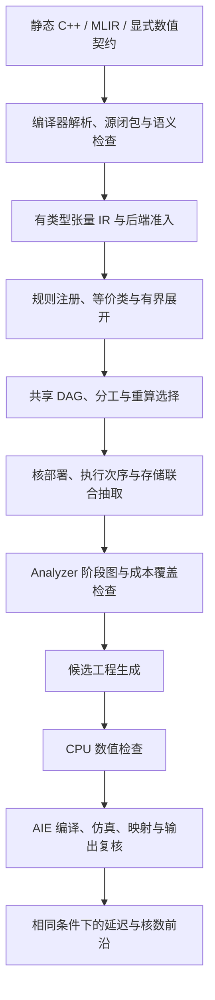

# AIE Optimizer

**面向 AMD AI Engine 的等价实现探索与联合优化研究原型。**

AIE Optimizer 从经过检查的计算语义出发，构造同一算法的多种实现，联合探索张量分工、计算复用、核内执行顺序、缓冲与核部署，再生成候选工程进行验证。目标是在固定核预算下降低延迟，并探索延迟—核数的 Pareto 方案。

本项目从 [AIE-PerfModel](https://github.com/lxy-littlechai/AIE-PerfModel) 的分析工作延伸而来。这里独立整理了 Optimizer 源码、必要的 Analyzer 支撑模块，以及公开的合成样例和测试。**目前是有明确支持边界的研究实现，尚不是任意 AIE C++/MLIR 的自动优化编译器。**

## 当前能做什么

| 层次 | 已实现 | 当前边界 |
| --- | --- | --- |
| 代码导入 | 基于 xDSL 的静态整数张量 MLIR 导入；基于 Clang AST 的 C++ 数组循环导入 | 导入范围大于代码生成范围；不支持的语义给出拒绝原因 |
| 语义与等价类 | 类型、形状和整数范围检查；可重放的改写记录；e-class 合并、hash-consing 与同余闭包 | 可信 Python 规则注册接口，不是外部形式化证明器 |
| 实现探索 | 通用 SSA 多输出等价类、共享 DAG 抽取；M/K/N 分解、矩阵重结合/因子合并、融合及逐节点实现族组合 | 有界结构覆盖与联合比较；每类一个代表，任意克隆/重算和布局仍待扩展 |
| 执行与部署 | 融合、核复用、独立核组、汇聚、累加器网格、输出直写、循环交换、scratch 调度 | 8 条已实现执行规则；cascade、通用 DMA 和布局自动优化尚待实现 |
| 成本与筛选 | AIE1 已编译候选接入完整 Analyzer；自动提取/准备、组件覆盖和条件排名；AIE-ML 保留原 ELF 限域模型 | AIE1 当前只在同编译程序内比较输入调度；跨编译语义绑定待接；AIE-ML DMA/锁与跨帧仍待校准 |
| 生成与验证 | 静态多层、多输出 SSA → 证明重放 → ADF/C++；注册式标量与 MMUL；另支持已有 AIE1 编译事实的导入评价 | 自动生成仍面向 AIE-ML / Vitis 2024.2；AIE1 生成与真实编译绑定待接 |

既有 MMUL 优化路径的数值契约为：

```text
H = Q0(X @ W0)
Y = Q1(H @ W1)

X, W0, W1: INT8
完整归约: INT32，检查溢出范围
Q0: sat8，可选 ReLU
Q1: sat8
shift = 0，无 bias
微块: 4 × 8 × 8
```

量化边界是等价改写的约束。例如 K 分片必须先完成 INT32 求和，再执行原量化，不能把各分片提前饱和后相加。

## 实现流程



源码阅读路线见 [架构与模块](docs/architecture.zh-CN.md)，支持边界和研究进度见 [状态与路线图](docs/status.zh-CN.md)。

## 通用图生成：多层、分支和多输出

`program-*` 入口直接消费完整导入图，不经过两层 `Spec` 准入。支持当前
张量 IR 的整数矩阵乘法、逐元素算术、整数转换、转置、静态切片、拼接、
常量与 splat；层数由图决定。原函数输入和结果全部保留在显式源绑定中，
运行时接口归一为按类型、按结果划分的 PLIO，帧补齐到 16 字节。

```bash
python -m Optimizer import-mlir tests/fixtures/optimizer_program/three_layer.mlir --output imported.json
python -m Optimizer program-import imported.json --max-cores 3 --output program.json
python -m Optimizer program-space program.json --max-plans 24 --output program-space.json
python tools/select_plan.py program-space.json program-plan.json --index 1
python -m Optimizer program-generate program.json program-plan.json --frames 4 --output program-candidate
python -m Optimizer cpu program-candidate
python -m Optimizer program-cost-request program.json program-plan.json --output cost-request.json
```

用同一流程检查三层矩阵链、FIR、分支图和 C++ 双输出样例：

```bash
python tools/program_reuse_witness.py --output reuse-witness
```

这组见证检查正确性和复用范围；候选索引不表示性能排名。新路径的
算子组合、规则扩展、成本接口及尚未解决的限制见
[第十一轮通用程序实现](docs/program-ir-v11.zh-CN.md)。

通用 SSA 还可进入多输出等价图，共享中间结果并组合不同计算结构。
抽取证书在生成入口重放，参考输出继续来自原程序：

```bash
python -m Optimizer program-egraph-space program.json --max-dags 16 --max-plans 64 --output egraph-space.json
python -m Optimizer program-egraph-generate egraph-space.json --index 1 --output candidate
python -m Optimizer cpu candidate
python tools/program_egraph_witness.py --output egraph-witness
```

无评价器时保留未知成本，索引不表示性能顺序。六类软件见证、结构
覆盖策略及边界见 [第十四轮等价图实现](docs/tensor-egraph-v14.zh-CN.md)。

通用后端的矩阵乘法还可逐节点选择已注册的 MMUL grid1x1/1x2，
组合于多层、分支和分工生成中。实现族同时提供守卫、生成回调和额外
暂存需求；打包开销包含在被评价的实现内。

```bash
python -m Optimizer program-kernels --output implementations.json
python -m Optimizer program-fit-model design.json train-artifacts.json --output model.json
python -m Optimizer program-freeze-predictions design.json model.json --output prediction-lock.json
python -m Optimizer program-space program.json --kernel-model model.json --model-frames 1 --output ranked-space.json
```

模型必须绑定冻结的原生 TRAIN 工程及其 ELF/profile，不能用手填周期
冒充校准。当前只覆盖特定单核、单帧 GEMM 家族；不支持的候选保留为
未知成本。机制、协议及结果见 [第十二轮微内核与成本验证](docs/microkernels-cost-v12.zh-CN.md)。

第十四轮改变了生成器身份；历史模型须随其冻结源码复现，不能改写
摘要后直接用于新版本。新原生实验需要重新冻结生成器与 TRAIN 设计。

## VCK190 / AIE1 已编译候选评价

完整 Analyzer 可以作为独立评价后端。先冻结外部 checkout 的 Model
源码，再通过隔离进程调用原公共 API，不与本仓库的基础 Model 子集混用：

```bash
python -m Optimizer analyzer-capture /path/to/full-AIE-PerfModel --output-directory build/analyzer-source
python -m Optimizer analyzer-candidate predict-request.json --output build/candidate.json
python -m Optimizer analyzer-evaluate build/candidate.json --backend build/analyzer-source/snapshot.json --output-directory build/evaluation --metric batch_complete
```

`analyzer-prepare` 可自动连接已有编译事实提取和正常请求准备；缺测成本
保持缺测。评价返回首帧完整完成及有限批次时间，保留完整结果、成本
覆盖与拒绝原因。当前比较组要求同一编译程序，并核对输入和成本场景；
跨编译、跨结构与跨核数比较还需要统一语义证明和生成绑定。
用法、实际 N16 一致性和支持边界见 [第十三轮接入报告](docs/analyzer-integration-v13.zh-CN.md)。

## 环境

- Python 3.11 或更新版本；基础规划、代码生成和阶段图使用 Python 标准库。
- CPU 数值检查需要 `g++` 在 `PATH` 中。
- MLIR 导入可选依赖：`xdsl==0.71.0`，见 [requirements-import.txt](Optimizer/requirements-import.txt)。
- C++ 导入可选依赖：`libclang==18.1.1`，见 [requirements-cpp-import.txt](Optimizer/requirements-cpp-import.txt)。
- 原生验证需要 Linux 上可用的 Vitis 2024.2 AIE-ML 工具链、对应平台 `.xpfm`，并事先加载工具链环境。SDK、平台和许可证不随仓库提供。

```bash
git clone https://github.com/yiling1-bot/AIE-Optimizer.git
cd AIE-Optimizer
python -m venv .venv
# Linux/macOS: source .venv/bin/activate
# Windows PowerShell: .\.venv\Scripts\Activate.ps1
python -m pip install -r requirements-dev.txt
```

只使用基础生成器时，可以省略可选依赖安装。以下命令均从仓库根目录执行。

## 快速体验：生成并检查一个候选

```bash
python -m Optimizer contract --max-cores 2 --output contract.json
python -m Optimizer generate contract.json --mode row_streaming --groups 1 --frames 4 --output candidate
python -m Optimizer cpu candidate
```

生成目录必须尚不存在。默认契约是 32×32 的两层计算；`candidate/` 包含代码、输入、golden、manifest 和 Analyzer 请求。CPU 检查成功返回 `status: passed`，验证的是生成计算代码与独立参考一致；ADF 锁、DMA、放置和硬件时序由后续原生步骤检查。

## 探索等价实现与核数

```bash
python -m Optimizer rules --output rules.json
python -m Optimizer joint-space contract.json --max-rounds 1 --max-terms 48 --max-applications 3 --max-states 64 --max-plans 24 --max-executions 4 --execution-depth 2 --output space.json
python tools/select_plan.py space.json selected-plan.json
python -m Optimizer ir-generate contract.json selected-plan.json --frames 4 --output ir-candidate
python -m Optimizer cpu ir-candidate
```

`space.json` 保留候选、推导、预算和评价状态。未提供阶段评价器时，候选标为 `needs_evaluator`；示例选出第一项用于演示生成，**并不代表它是最快方案**。可通过 `tools/select_plan.py --index N` 选择其他项。

基础生成器还保留五类实现作为回归入口：`materialized`、`full_reuse`、`row_streaming`、`hidden_accumulation` 和 `recompute`。新的探索路径由已注册规则和执行 IR 驱动。

## 从现有代码导入

MLIR 合成样例：

```bash
python -m Optimizer import-mlir tests/fixtures/optimizer_import/two_layer.mlir --output mlir-import.json
python -m Optimizer import-check mlir-import.json --cases 8 --output mlir-check.json
python -m Optimizer import-contract mlir-import.json --max-cores 2 --output mlir-contract.json
python -m Optimizer import-export mlir-import.json --output roundtrip.mlir
```

C++ 合成样例：

```bash
python -m Optimizer import-cpp tests/fixtures/optimizer_cpp/two_layer.cpp --entry network --output cpp-import.json
python -m Optimizer import-check cpp-import.json --cases 8 --output cpp-check.json
python -m Optimizer import-contract cpp-import.json --max-cores 2 --output cpp-contract.json
python -m Optimizer generate cpp-contract.json --mode row_streaming --groups 1 --frames 4 --output cpp-candidate
python -m Optimizer cpu cpp-candidate
python -m Optimizer import-artifact-check cpp-candidate --output same-input-check.json
```

C++ 入口读取真实编译器 AST，从操作符、类型、索引及调用恢复计算；`import-check` 另行编译捕获的原始 C++，比较原程序与导入 IR。当前支持静态二维数组引用、受检查的循环与纯辅助函数；输入只读，输出需要 `__restrict`。无编译数据库时默认 C++20；使用 `--compile-db` 时要求精确匹配源文件及显式语言标准。导入证据绑定捕获时的编译器库，跨主机需要重新导入。

`import-export` 导出捕获的原始源码或源闭包，保留源接口；**尚未把优化后的结构重新写回任意原 C++/MLIR 接口**。AIE 专用 API 的 AST 审计也不等于这些 API 已被自动提升成数学语义。

## 原生编译、仿真与前沿

在具备工具链的 Linux 主机上：

```bash
python -m Optimizer native candidate --platform /absolute/path/to/platform.xpfm
python -m Optimizer review candidate
python -m Optimizer frontier candidate/native_review.json --output frontier.json
```

多个 `native_review.json` 可一同传给 `frontier`。只有输出正确、映射吻合、比较条件一致的已验证候选才能进入原生前沿。

既有两层生成器的接口为 X/W0/W1 三个完整帧的 128-bit 输入 PLIO，以及一个输出 PLIO；权重逐帧变化。通用程序路径按完整源图提供多个有类型的输入和输出 PLIO。首输出指标为仿真起点到首帧全部结果完成，包含启动阶段。这与原工程接口、单 kernel 周期及板卡端到端延迟分别有不同边界，应按相同接口、输入、工具链、平台及计时条件比较。

## 测试

```bash
python -m unittest discover -s tests -p "test_optimizer*.py" -v
```

完整套件包含 **224 项测试**，覆盖改写重放、类型等价类、多输出共享 DAG 抽取、执行规则、生成代码、成本拒绝与资源阶段，以及 C++/MLIR 导入、完整程序组合生成、注册式微内核、冻结留出协议和隔离 Analyzer 评价。安装两组可选依赖并提供 `g++` 后可运行完整套件；缺少可选依赖时部分测试会跳过。测试里的成本和编译报告可使用合成数据，它们不构成 AIE 硬件性能证据。

## 项目目录

```text
Optimizer/              CLI、语义、等价探索、执行、生成和验证
  importing/            C++/MLIR 导入、准入、源重放与 AST 审计
Model/Timing/           Optimizer 使用的 Analyzer 支撑模块子集
tests/                  回归测试与公开合成输入
tools/                  候选选择小工具
docs/                   架构、能力边界和后续研究路径
requirements-dev.txt    完整测试所需的可选前端依赖
```

## 后续方向

优先将通用算子 lowering 扩展为可注册的高性能实现族，接入 MMUL 和编译周期证据；继续恢复锁/DMA/缓冲成本，用留出候选检验模型排名，并扩大等价抽取、代码导入和真实应用覆盖。文献中的方法需要落实为带合法性条件、可执行回调、代码生成和验证的规则；既有 `rules` 输出中的 `specified_not_implemented`、`guard_only` 和 `checker_only` 均不代表已有完整优化器支持。

## 来源与许可

感谢 [AIE-PerfModel](https://github.com/lxy-littlechai/AIE-PerfModel) 提供研究起点。Analyzer 支撑子集与本项目的关系见 [NOTICE.md](NOTICE.md)。论文链接用于记录机制来源，不表示本项目复现了论文的完整系统或性能。

当前发布未指定开源许可证；公开可见不等于授予任意使用或再分发许可。第三方工具及依赖遵循各自许可证。
