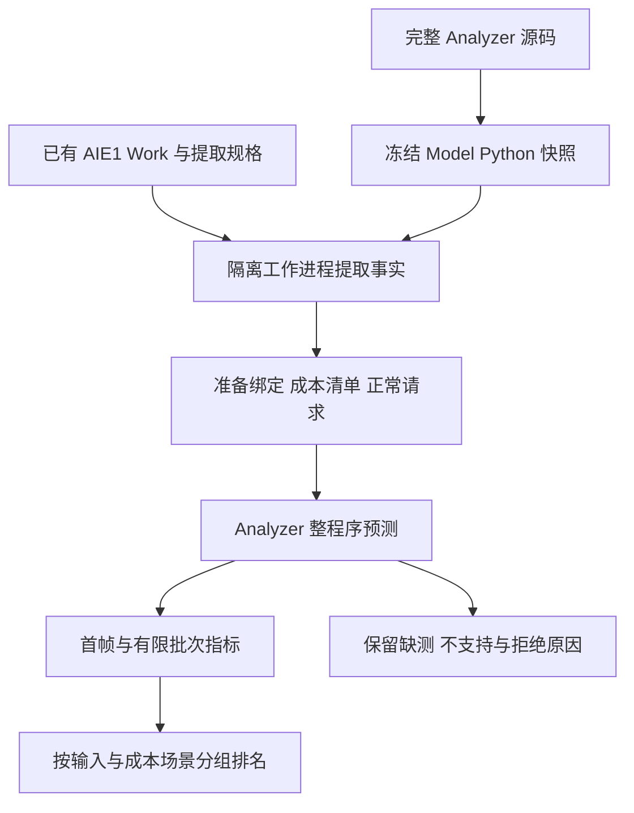

# 第十三轮：VCK190／AIE1 Analyzer 评价器接入

日期：2026-10-18。此轮完成已编译候选的评价接口、自动提取/准备、
条件排名及拒绝路径。当前通用 ADF 生成器继续面向 AIE-ML；新增路径
消费已有 AIE1 编译产物，未把 AIE-ML 生成计划改为 AIE1，也未实现
SSA/e-graph 的跨编译语义绑定。

## 模块与流程



| 模块 | 职责 |
| --- | --- |
| `compiled_analyzer.py` | 冻结外部源码、候选身份、隔离调用、自动准备、结果规范化及 `AnalyzerEvaluator` 回调 |
| `compiled_analyzer_worker.py` | 使用 `python -I` 加载冻结的外部 `Model`，调用原公共 API，保存完整结果与回执 |
| `compiled_search.py` | 复用既有排名逻辑，在已核验的比较组内计算条件顺序与前沿；保留未知候选 |
| `packet_schedules.py` | 可注册的有限 packet 调度见证族；保持逐目的端 FIFO、header、payload、TLAST |

完整 Analyzer 不复制进本仓库的 `Model` 子集。`analyzer-capture` 将用户
指定 checkout 的 `Model/**/*.py` 复制到独立输出目录，记录逐文件摘要。
每次查询前后核对源码、完整输入 pin 及适配器源码身份。

工作进程独立导入，避免两个仓库的同名 `Model.Timing` 在主进程中互相
覆盖。SDK、平台和 TRAIN 原始数据不由源码捕获命令复制或下载；它们
仍通过普通请求中的完整引用定位。

## 正常使用

从 Optimizer 仓库根目录执行，输出须为新目录或新文件：

```bash
python -m Optimizer analyzer-capture /path/to/full-AIE-PerfModel --output-directory build/analyzer-source

python -m Optimizer analyzer-candidate predict-request.json --label baseline --output build/baseline.json
python -m Optimizer analyzer-evaluate build/baseline.json --backend build/analyzer-source/snapshot.json --output-directory build/baseline-evaluation

python -m Optimizer analyzer-prepare extraction-spec.json preparation-template.json --backend build/analyzer-source/snapshot.json --output-directory build/prepared-candidate
python -m Optimizer analyzer-evaluate build/prepared-candidate/candidate.json --backend build/analyzer-source/snapshot.json --output-directory build/prepared-evaluation
```

`extraction-spec.json` 使用 Analyzer 原有的
`aie-compiled-program-extraction-spec-v1`。准备模板使用原有
`aie-compiled-request-preparation-v1` 字段，要求 `metadata_ref=null`，
且 `compiler_inputs` 与提取规格完全相同。适配器把本次新提取的 metadata
传给准备入口，其余源 CSV、预算、成本库和相关成员保持显式。

`analyzer-prepare` 读取已有 Work，不执行 AIE 编译、Simulator 或拟合。
`cost_registry=null`、`model_selection=null` 时，原准备器生成缺测模板
和 costs 请求；成本齐全且显式选择成员时才产生 predict 请求。

调用 `AnalyzerEvaluator(snapshot, bindings, output, architecture=...)` 可作为
计划评价回调。未绑定计划返回 `needs_analyzer_binding`；目标、计划 ID
和实际核数需一致。这个映射不是数学等价证明，新结构还需要独立的
语义/生成/编译绑定后才能用于统一抽取。

## 比较边界

第一版只在**同一编译程序**内开放两种输入政策：

| 政策 | 比较依据 |
| --- | --- |
| `exact_inputs` | 每个源的完整 CSV 内容相同，保留全部输入条件 |
| `dense_packet_interleaving` | 显式允许改变不同目的端的 packet 交织；逐源、逐 packet ID 的完整包序列保持相同 |

第二种政策独立解析每个完整包，保留完整 header、payload、TLAST 及
同目的端调用顺序；拒绝 STALL，不把它删除后当作相同输入。改变 payload
或同目的端调用顺序会产生不同比较组。

比较键还包含真实编译身份、绑定摘要和政策。场景键绑定冻结 Analyzer
及完整成本库与显式相关成员选择。不同组分别输出排名，不拼接不同
相关成员的局部最佳参数，不跨组产生全局赢家。

当前尚不能用用户自填的 workload 名称把两个不同编译程序强行放入
同一组。因此跨布局、跨核数和不同计算结构的 Pareto 尚未接通。
后续应以共同 SSA 数值契约、可重放等价证据、生成文件与编译绑定替换
这里的“相同编译”约束，再开放跨编译比较。

## 成本、时延和支持状态

原 Analyzer 在内部共同处理计算、cascade、输入路径、DMA/wrapper、
启动和输出成本。Optimizer 消费整程序结果，不再叠加一份核内周期或
另一份 DMA 常数。

规范化结果保留：

- `conditional_latency_ns`：首帧所有输出**完整完成**；不是首个有效 word。
- `conditional_frame_completion_ns`：所有完整帧的完成时刻。
- `analyzer_timing_prediction`：原 API 的仿真原点至末有效 SDK FILE 指标。
- `latency_ns=null`、`native_admitted=false`：预测不变成实测时间。
- 成本角色覆盖、缺测项、不支持资源和拒绝原因。

`analyzer-evaluate --metric first_output` 选择首帧完整完成，
`--metric batch_complete` 选择有限批次完成，默认后者。
只有具备完整 TRAIN 成本、可执行绑定且由实际编译后端返回的条件预测
才能进入该排名。软件 fixture、costs-only、缺测和不支持候选没有排名
分数；它们保留在报告中。超时进程受限终止，不隐式重试。

一个 batch 最多 32 个候选。相同精确请求可复用结果，但仍核对完整
input refs；相同 compiler/binding/registry 的不同查询复用原
`PreparedAnalyzer`，最多保存两个准备上下文。解析上下文复用与精确
请求复用分别记录，两个指标都不构成新性能/精度样本。

## 调度见证

```bash
python -m Optimizer analyzer-schedule-space predict-request.json --output-directory build/schedule-space
python -m Optimizer analyzer-evaluate build/schedule-space/space.json --backend build/analyzer-source/snapshot.json --output-directory build/schedule-evaluations --metric batch_complete
```

初始规则为原顺序、round-robin、按目的端升序和降序分组。规则有 ID、
版本与可调用排序器；生成后重新核对 FIFO/payload 签名并去重。
这是一组用于检验评价链路的候选，不是通用结构优化器的替代实现。

## 本轮验证

**206 项回归全部通过，无跳过。** 新增 19 项测试覆盖快照变化、同名
模块隔离、数据/身份篡改、精确查询与准备上下文复用、指标选择、目标
与核数失配、多输出帧完整性、软件成本隔离、缺测保留、超时，以及
packet FIFO 与 STALL 拒绝。协议测试使用明确的 fake API，不是硬件证据。

实际接口使用冻结的 114 份 Analyzer Model Python 文件。真实 N16
既有请求通过适配器后的完整结果与直接调用逐项相同。重新执行正常
提取和准备后，资源图、全部组件成本与完整 prediction 对象仍相同：

| 检查 | 结果 |
| --- | --- |
| 实际计算核 | 16 |
| 组件成本角色 | 115/115 reused，TRAIN 均可用 |
| 首帧所有输出完整完成 | 71.135 µs |
| 四帧批次完成 | 255.695 µs |
| 空成本库自动准备 | 115 个角色均 needs_measurement；无预测请求/时延 |

固定同一编译程序、成本点及逐目的端输入序列的六候选检查：

| 候选 | 有限批次预测 / µs | 状态 |
| --- | ---: | --- |
| 原交织顺序 | 255.695 | conditional_estimate |
| round-robin | 255.700 | conditional_estimate |
| 按目的端升序分组 | — | needs_measurement：owner/rearm 受限转移缺合同 |
| 按目的端降序分组 | — | needs_measurement：owner/rearm 受限转移缺合同 |
| 历史 reverse 输入回放 | 255.925 | conditional_estimate |
| 刻意空置的成本上下文 | — | needs_measurement：115 个成本角色缺测 |

三个可预测候选进入同一比较组，三个缺测候选均保留；没有给后者填 0
或无穷大。reverse 结果与既有历史预测一致，不计新 HO。

这一次六候选批量运行约 87.8 s，包含准备、求解、结果写入和复核；与
上一轮单查询的 9.2 s 口径不同，不用于宣称严格加速比。已知两个相近
方案只差 5 ns，且未补新原生复验，不能据此宣称可靠排序或优化收益。

本轮新编译 **0**、Simulator **0**、成本拟合 **0**、新精度样本 **0**。
它验证接入正确和支持边界保持。原 AIE-ML 微内核生成/模型路径保留；
本轮没有修改其 IR、规则、规划器、生成器或数值成本。

本地材料在 `output/research/AIE-Optimizer/phase13/`：
`first-adapter-equality.json`、`automatic-pipeline-equality.json`、
`final-candidate-evaluations/`、`unmeasured-prepared-evaluation/`、
`tests-checkpoint.*` 和冻结源码。引用保留绝对路径和完整 pin，跨机器
复现需恢复这些路径或重新生成绑定与引用，历史结果不回写。

## 后续实现接缝

1. 通用 SSA → 有类型、多输出根的 e-graph；M/K 等规则返回局部等价
   关系和可重放证据，再接共享 DAG 抽取。
2. 以目标后端实现注册生成真正的 AIE1 候选，建立等价证明 → 生成
   文件 → 真实编译事实的绑定，支持跨编译、同工作量比较。
3. 用此评价回调驱动结构、共享/复制、实现与部署选择；缺少模型覆盖
   的分支保留，不能提前按 MAC 或不可靠点预测删除。
4. 为 owner-limited DMA、fanout/join、共享核、跨 actor window 等机制
   补执行原语、成本和留出验证。VCK190 数值模型不迁移为 AIE-ML 数值。
